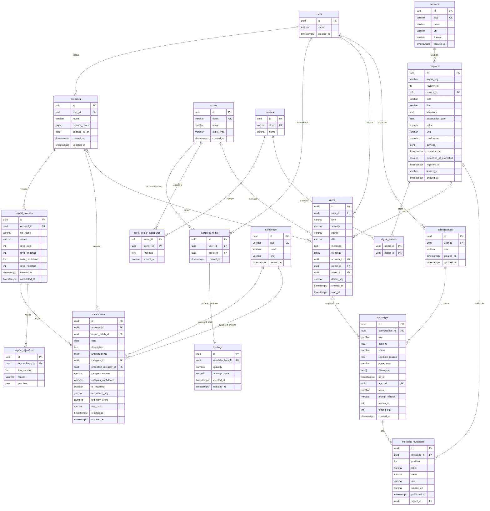

# Modelagem de dados do Postgres — Design

> **Issue #14 (10/11/2026):** importação de CSV e consulta de lotes implementadas em `services/api/src/valyra/finance/` (router, service, repository, schemas), com OpenAPI regenerado. Consultas da #15 continuam planejadas. Estado atual em [arquitetura](architecture.md).

> **Integração #11/#12 (08/11/2026):** persistência/seed #17, domínio CSV #19 e core HTTP mínimo (/health, erros, paginação, OpenAPI) estão implementados nesta branch. Endpoints Finance #14/#15, projeções e módulos analíticos continuam planejados. A [arquitetura atual](architecture.md) e o [registro de integração](integracao-11-12.md) atualizam o estado; notas históricas anteriores abaixo descrevem suas respectivas etapas.

> **Atualização de 08/11/2026 — Issue #10.** O Finance inicial tem modelos SQLAlchemy, Alembic, migração, seed e testes em `services/api/`, validados em PostgreSQL 18.6. A equipe autorizou os refinamentos de nulabilidade/defaults, exclusões, FK composta, checks e conflitos do seed. Resultados e comandos estão no [registro de implementação](revisao-modelagem.md). Alpha, IA, alertas, parser e HTTP continuam planejados.

| Campo | Valor |
|---|---|
| Status | Finance inicial autorizado para implementação; demais domínios em revisão |
| Data | 07/11/2026 |
| Base | Documento de Alinhamento v0.3, [fundação técnica](spec-tecnica.md) e Issues [#7](https://github.com/UaiScript/valyra-hackbrasil-2026/issues/7) / [#10](https://github.com/UaiScript/valyra-hackbrasil-2026/issues/10) |
| Escopo | Schema do PostgreSQL: dados do app e tabela `signals` |
| Fora de escopo | Séries históricas em DuckDB/Parquet (spec próprio), modelos preditivos, telas |

## Como ler este documento

O conteúdo foi construído no brainstorming de 07/11 e está aberto à revisão do time. Itens marcados como **[Altera fundação]** mudam algo já definido no spec de fundação técnica; a seção 10 lista esses impactos.

**[Registrado]** indica uma regra explícita das Issues consultadas ou do desenho anterior; não significa implementação de todo o desenho. **[Aprovado para #10]** identifica os refinamentos autorizados para a persistência inicial. **[Proposta]** continua indicando escolhas de comportamento ainda não fechadas, inclusive fora desta implementação. A seção 4 é a referência do Finance; o [contrato](api-design.md) trata das interfaces e o [registro da migração](revisao-modelagem.md) reúne dependências, seed e validação.

---

## 1. Premissas do MVP

- **Um único usuário demo, sem login.** Mesmo assim existe a tabela `users` e as tabelas dependentes têm `user_id`, para não exigir migração se houver login no futuro.
- **Transações entram por upload de CSV** feito pelo usuário na demo.
- **Categorização automática** (regras/ML) com correção pelo usuário.
- **Alertas persistidos**, com status novo/lido.
- **Sinais ligados a ativos por setor**, com a justificativa guardada na relação ativo ↔ setor.
- **Watchlist com posições** (quantidade e preço médio).
- **Abordagem de histórico:** tabelas do app relacionais e atualizáveis; `signals` **somente inserção**, com revisões como linhas novas.

Alternativas descartadas para o histórico:

- `signals` atualizável com histórico em tabela separada: duas fontes da verdade e Replay dependente de reconstrução.
- Event sourcing geral: complexidade alta sem exigência do produto.

---

## 2. Diagrama entidade-relacionamento

O GitHub renderiza o diagrama abaixo automaticamente.



---

## 3. Convenções gerais

### 3.1 Identificadores

- Chave primária `UUID` com default `gen_random_uuid()`.
- Motivo: repositório e demo públicos (sem IDs sequenciais expostos) e escrita por API e pipelines sem disputa de sequência.

### 3.2 Nomes

Configurados uma vez na `MetaData` de `core.db.Base`, incluída como dependência mínima da Issue #10, compatível com a interface da #9:

- Tabelas em `snake_case` no plural; chaves estrangeiras `<entidade>_id`.
- Constraints com prefixos fixos: `pk_`, `fk_`, `uq_`, `ix_`, `ck_`.

```python
NAMING_CONVENTION = {
    "pk": "pk_%(table_name)s",
    "fk": "fk_%(table_name)s_%(column_0_name)s_%(referred_table_name)s",
    "uq": "uq_%(table_name)s_%(column_0_N_name)s",
    "ix": "ix_%(table_name)s_%(column_0_N_name)s",
    "ck": "ck_%(table_name)s_%(constraint_name)s",
}
```

### 3.3 Tipos

| Uso | Tipo | Regra |
|---|---|---|
| Dinheiro no Finance | `BIGINT` | Centavos de BRL; nomes `*_cents`; nunca `float` |
| Valor de transação | `BIGINT` | Negativo = saída, positivo = entrada; `CHECK (amount_cents <> 0)` |
| Quantidade de ativo | `NUMERIC(18,6)` | `CHECK (quantity > 0)` |
| Scores e confiança | `NUMERIC(4,3)` / `NUMERIC(5,4)` | Entre 0 e 1 |
| Data de negócio | `DATE` | Sem fuso |
| Instante | `TIMESTAMPTZ` | Gravado em UTC |
| Enum | `VARCHAR` + `CHECK` | Não usar enum nativo do Postgres |
| Estrutura variável | `JSONB` | Somente `alerts.evidence` e `signals.payload` |

`balance_cents = 500000` significa R$ 5.000,00; `amount_cents = -12990` significa saída de R$ 129,90. Na API são inteiros JSON, sem aspas ou formatação. Conversões devem partir de texto decimal validado ou aritmética decimal exata; não usar `float`, nem truncar frações de centavo silenciosamente. A Issue #13 define rejeitar valores CSV com mais de duas casas, conforme o [contrato de entrada](api-design.md#entrada-csv-e-domínio--issue-13).

Quantidade, indicadores, scores e confiança não são dinheiro. `holdings.average_price` e valores genéricos de Alpha/IA têm pendências específicas nas seções 5.4 e 7; esta revisão não define arredondamento para esses casos.

### 3.4 Colunas padrão

- As colunas temporais são as explicitadas em cada tabela e no diagrama. Não se presume `created_at` nas tabelas de relação nem em `import_rejections`.
- No Finance inicial, `accounts` e `transactions` têm `created_at` e `updated_at`; `users` e `categories` têm somente `created_at`; `import_batches` registra criação e término. Acrescentar outros timestamps exigiria novo alinhamento.
- **[Aprovado para #10]** Onde presentes no Finance, `created_at` recebe `CURRENT_TIMESTAMP`; `updated_at` inicia com o mesmo instante e tem `onupdate=CURRENT_TIMESTAMP` no SQLAlchemy, com `CHECK (updated_at >= created_at)`. Preservar `created_at` é responsabilidade de quem escreve; não há trigger de imutabilidade. SQL direto fora do SQLAlchemy precisa manter `updated_at` explicitamente; não foi criado trigger de atualização automática.
- `signals` não tem `updated_at`.
- Sem soft delete.

### 3.5 Donos das tabelas

| Módulo | Tabelas |
|---|---|
| `core/` | `users` |
| `finance/` | `accounts`, `import_batches`, `import_rejections`, `categories`, `transactions` |
| `alpha/` | `sources`, `signals`, `signal_sectors`, `sectors`, `assets`, `asset_sector_exposures`, `watchlist_items`, `holdings` |
| `alerts/` **[Altera fundação]** | `alerts` |
| `ai/` | `conversations`, `messages`, `message_evidences` |

Chaves estrangeiras entre módulos são permitidas no banco. Em código, o acesso continua só via `service` do outro módulo.

---

## 4. Finance

### 4.1 Tabelas

As seis tabelas abaixo estão representadas no ORM e na migração `0001_finance_inicial`; a validação em PostgreSQL está descrita no registro de implementação. **NN** = `NOT NULL`; **NULL** = opcional; **—** = sem default, informado na escrita. IDs têm default `gen_random_uuid()` conforme a seção 3.1; o seed fornece IDs explícitos. Nulabilidade, defaults, índices e constraints documentados foram autorizados para a Issue #10. Valores escritos pelo service futuro da #14 permanecem distintos dos defaults do DDL.

**`users`** (`core`) — uma linha identifica o usuário demo; não representa login ou sessão.

| Coluna | Tipo / nulabilidade | Default | Chave / significado |
|---|---|---|---|
| `id` | UUID NN | `gen_random_uuid()` | PK; demo configurado por `DEMO_USER_ID` |
| `name` | VARCHAR NN | — | Nome de exibição |
| `created_at` | TIMESTAMPTZ NN | `CURRENT_TIMESTAMP` | Criação |

Índices: somente o da PK. **[Aprovado para #10] Exclusão:** `RESTRICT` quando houver contas; demais domínios continuam fora desta migração.

**`accounts`** — uma linha representa uma conta do usuário e seu saldo de referência, não o saldo recalculado do dia.

| Coluna | Tipo / nulabilidade | Default | Chave / significado |
|---|---|---|---|
| `id` | UUID NN | `gen_random_uuid()` | PK |
| `user_id` | UUID NN | — | FK `users(id)` |
| `name` | VARCHAR NN | — | Ex.: "Conta principal" |
| `balance_cents` | BIGINT NN | — | Saldo de referência em centavos, inclusive negativo |
| `balance_as_of` | DATE NN | — | Data de referência; convenção proposta na seção 4.2 |
| `created_at`, `updated_at` | TIMESTAMPTZ NN | `CURRENT_TIMESTAMP` | Seção 3.4 |

**[Aprovado para #10]** Índice `(user_id)`; check temporal da seção 3.4. FK de usuário com `ON DELETE RESTRICT`; excluir conta com lotes ou transações também é bloqueado. Não há cascata de histórico financeiro nem default implícito de saldo zero.

**`import_batches`** — uma linha representa uma tentativa de importar um CSV para uma conta, inclusive reenvios do mesmo arquivo.

| Coluna | Tipo / nulabilidade | Default | Chave / significado |
|---|---|---|---|
| `id` | UUID NN | `gen_random_uuid()` | PK |
| `account_id` | UUID NN | — | FK `accounts(id)`; conta escolhida no upload |
| `file_name` | VARCHAR NN | — | Nome recebido; não é chave de deduplicação |
| `status` | VARCHAR NN | `'processing'` | `processing` \| `completed` \| `failed` |
| `rows_total` | INT NN | `0` | Quantidade de registros de dados contabilizados |
| `rows_imported` | INT NN | `0` | Novas transações persistidas neste lote |
| `rows_duplicated` | INT NN | `0` | Registros já existentes, não inseridos |
| `rows_rejected` | INT NN | `0` | Registros inválidos com detalhe de rejeição |
| `created_at` | TIMESTAMPTZ NN | `CURRENT_TIMESTAMP` | Início |
| `completed_at` | TIMESTAMPTZ NULL | `NULL` | Término; semântica abaixo |

**[Registrado, Issue #10]** `CHECK (status IN ('processing','completed','failed'))`.

**[Aprovado para #10] Integridade no banco:**

- Cada contador é `>= 0`; `rows_imported + rows_duplicated + rows_rejected <= rows_total`. Avaliar a soma promovendo os contadores para `BIGINT` para não estourar `INT`.
- Se `status = 'completed'`, exigir igualdade nessa soma. A Issue #14 registra conclusão mesmo com rejeições de linhas. Para um registro `failed`, os checks permitem contagem parcial; a decisão de persistir essa tentativa continua pendente, conforme a seção 4.5.
- `processing` exige `completed_at IS NULL`; `completed` e `failed` exigem `completed_at IS NOT NULL` e `completed_at >= created_at`. O campo significa término de qualquer resultado terminal persistido.
- `UNIQUE (id, account_id)` como alvo da FK composta de `transactions`; índice `(account_id)` para consulta e FK. FK de conta com `ON DELETE RESTRICT`.

Contagem de registros segue o [contrato CSV da Issue #13](api-design.md#entrada-csv-e-domínio--issue-13). A conciliação pelo service e os limites das garantias do banco estão nas seções 4.4 e 4.5. **[Proposta]** Lotes terminais não são reabertos; reenvio cria outro lote conforme o fluxo da Issue #14.

**`import_rejections`** — uma linha guarda o motivo consolidado de rejeição de um registro de dados do lote.

| Coluna | Tipo / nulabilidade | Default | Chave / significado |
|---|---|---|---|
| `id` | UUID NN | `gen_random_uuid()` | PK |
| `import_batch_id` | UUID NN | — | FK `import_batches(id)` |
| `line_number` | INT NN | — | Linha física do arquivo; cabeçalho = 1 (#13); registros multilinha ainda exigem alinhamento |
| `reason` | VARCHAR NN | — | Motivo legível de rejeição |
| `raw_line` | TEXT NN | — | Texto rejeitado conforme contrato CSV/HTTP |

**[Aprovado para #10]** `CHECK (line_number > 0)` e `UNIQUE (import_batch_id, line_number)`; o índice da unicidade cobre a consulta pelo lote. FK com `ON DELETE CASCADE`: detalhes só são removidos junto de um lote cuja exclusão seja permitida (sem transações). Não há timestamp próprio; o contexto temporal vem do lote.

**`categories`** — uma linha representa uma categoria global fixa do seed; o usuário não cria categorias.

| Coluna | Tipo / nulabilidade | Default | Chave / significado |
|---|---|---|---|
| `id` | UUID NN | `gen_random_uuid()` | PK |
| `slug` | VARCHAR NN | — | UNIQUE; identidade usada no seed |
| `name` | VARCHAR NN | — | Nome de exibição |
| `kind` | VARCHAR NN | — | `expense` \| `income` |
| `created_at` | TIMESTAMPTZ NN | `CURRENT_TIMESTAMP` | Criação |

**[Registrado, Issue #10]** `CHECK (kind IN ('expense','income'))`; as 12 categorias estão no [seed](revisao-modelagem.md#seed-da-issue-10). PK e unicidade de `slug` bastam como índices. **[Aprovado para #10] Exclusão:** `RESTRICT` nas referências atual e prevista, preservando classificação e sugestão original.

**`transactions`** — uma linha representa uma movimentação importada, com sinal, conta, lote de origem e classificação.

| Coluna | Tipo / nulabilidade | Default | Chave / significado |
|---|---|---|---|
| `id` | UUID NN | `gen_random_uuid()` | PK |
| `account_id` | UUID NN | — | FK `accounts(id)` |
| `import_batch_id` | UUID NN | — | Parte da FK composta para o lote e sua conta |
| `date` | DATE NN | — | Data de negócio da movimentação |
| `description` | TEXT NN | — | Descrição recebida |
| `amount_cents` | BIGINT NN | — | Entrada positiva; saída negativa; diferente de zero |
| `category_id` | UUID NN | — | FK `categories(id)`; categoria exibida |
| `predicted_category_id` | UUID NN | — | FK `categories(id)`; sugestão original preservada |
| `category_source` | VARCHAR NN | — | `rule` \| `model` \| `user` |
| `category_confidence` | NUMERIC(4,3) NULL | `NULL` | Confiança da sugestão original, entre 0 e 1 inclusive |
| `is_recurring` | BOOLEAN NN | `false` | Identificação de recorrência |
| `recurrence_key` | VARCHAR NULL | `NULL` | Descrição normalizada que agrupa recorrências |
| `anomaly_score` | NUMERIC(5,4) NULL | `NULL` | Entre 0 e 1 inclusive; pode ser recalculado |
| `row_hash` | VARCHAR NN | — | SHA-256 hexadecimal de 64 caracteres (#13) |
| `created_at`, `updated_at` | TIMESTAMPTZ NN | `CURRENT_TIMESTAMP` | Seção 3.4 |

**[Registrado, Issue #10]** `UNIQUE (account_id, row_hash)`, `CHECK (amount_cents <> 0)`, `CHECK (category_source IN ('rule','model','user'))`; índices `(account_id, date)` e `(category_id)`.

**[Aprovado para #10]** FK composta `(import_batch_id, account_id) REFERENCES import_batches(id, account_id)` para impedir que uma transação use lote de outra conta. Ela substitui a FK simples de lote; mantém-se a FK de conta. Todas essas FKs usam `ON DELETE RESTRICT`, sem alteração de identidade da conta/lote. Índices adicionais `(import_batch_id, account_id)` e `(predicted_category_id)` cobrem referências e consultas. Checks dos scores: `category_confidence IS NULL OR category_confidence BETWEEN 0 AND 1` e equivalente para `anomaly_score`; check temporal conforme seção 3.4.

`balance_cents` e `amount_cents` usam um tipo SQLAlchemy com armazenamento `BIGINT` e bind estrito: floats, strings, decimais e booleanos são rejeitados antes da escrita, inclusive em inserts em lote. Não foi definido teto monetário de negócio; a faixa física continua sendo a de `BIGINT`.

**[Proposta] Exclusão de transação:** não oferecer remoção física no fluxo inicial, pois ela quebraria a conciliação histórica de `rows_imported` e permitiria reimportação do hash removido. FKs não impedem apagar a própria linha; a política deve ser respeitada pelo service/permissões futuros. Uma função de exclusão exigiria alinhar os contadores e a auditoria.

### 4.2 Saldo e datas

**[Registrado no desenho anterior]** O saldo é derivado da referência da conta e das transações posteriores; não existe coluna de saldo diário. O desenho não definia se a referência era de abertura ou fechamento nem o limite superior da soma.

**[Proposta de convenção]** `balance_cents` é o saldo de **fechamento** de `balance_as_of`, já incluindo todas as movimentações dessa data. Para uma data de consulta `D >= balance_as_of`:

```text
saldo_realizado_cents(D) = balance_cents
  + soma(amount_cents onde balance_as_of < date <= D)
```

Para hoje, propõe-se obter `D` pelo calendário `America/Sao_Paulo`; timestamps continuam em UTC. Transações da data de referência ou anteriores não entram novamente. Consulta anterior à referência não pode ser reconstruída por essa fórmula e deve ser tratada como indisponível.

Exemplo: referência `500000` em `2026-11-01`; movimentação `-12990` em `2026-11-02`; realizado em `2026-11-07` = `487010` (R$ 4.870,10). Uma linha de `-20000` em `2026-11-10` não participa desse realizado. Confirmar a convenção antes de implementar cálculos ou importar extratos que tragam saldo de abertura.

O modelo representa movimentações efetivadas de extrato, sem estado de agendamento/liquidação. A data futura fica excluída do realizado na data de consulta; contas previstas e projeções não devem ser gravadas como movimentações realizadas. `date <= D` só é suficiente sob essa premissa de origem; suportar agendamentos exigiria outro alinhamento.

### 4.3 Categorização, deduplicação e cálculos

- **[Registrado, Issues #13/#14] Deduplicação:** SHA-256 por conta e índice de ocorrência no arquivo. Normalização, expressão exata e índice inicial estão no [contrato do domínio](api-design.md#entrada-csv-e-domínio--issue-13). Duas transações idênticas no mesmo dia e arquivo são aceitas; o reenvio do mesmo CSV não duplica.
- **Limitação:** o índice é local ao arquivo. Se um CSV tem duas movimentações idênticas e outro contém apenas uma delas, não há como identificar universalmente qual é a mesma movimentação. Arquivos parcialmente sobrepostos podem confundir movimentações distintas com duplicatas; o hash não garante conciliação universal nem substitui um identificador bancário estável.
- **[Registrado] Correção pelo usuário:** altera `category_id` e grava `category_source = 'user'`; `predicted_category_id` não muda. **[Proposta]** Preservar também a confiança original; a escrita deve atualizar `updated_at`. Essa imutabilidade depende do service futuro; a FK sozinha não a garante.
- **[Registrado, Issues #13/#14] Classificação e fallback:** regras por sinal, slugs de fallback e valores iniciais da transação estão no [contrato do domínio](api-design.md#entrada-csv-e-domínio--issue-13). Ausência de score não equivale a zero. **[Proposta]** O service deve validar também a compatibilidade do `kind` das categorias resolvidas com o sinal, incluindo a prevista; um `CHECK` simples não consulta outra tabela.
- **[Registrado no desenho]** Dashboard, recorrências, gastos atípicos e projeção são cálculos futuros em `finance/domain.py`, sem tabelas próprias. Não há código desses cálculos. A projeção deve identificar valores previstos separadamente do realizado; precisão de estimativas e limiar de anomalia continuam pendentes.

### 4.4 Responsabilidade das validações

| Camada prevista | Responsabilidade | Fonte principal |
|---|---|---|
| Banco / ORM | `NOT NULL`, PKs/FKs, `UNIQUE (account_id, row_hash)`, checks de linha e FK composta autorizados e presentes no ORM/migração; bind estrito de dinheiro no SQLAlchemy | Seção 4.1 e Issue #10 |
| Importador / domínio | Ler e validar CSV, converter dinheiro sem `float`, normalizar cópia da descrição, calcular hash e categorizar por regras/fallback; sem banco ou HTTP | [Contrato CSV/domínio](api-design.md#entrada-csv-e-domínio--issue-13), Issue #13 |
| Router / schemas HTTP | Limitar leitura do upload, validar parâmetros e inteiro estrito no PATCH; traduzir `CsvFormatError` para `AppError` | [Operações e erros HTTP](api-design.md#operações-http--issues-14-e-15), Issues #9/#14/#15 |
| Service | Validar propriedade da conta pelo demo via `get_account_for_user`; controlar a transação de importação, resolver categorias do seed, conciliar contadores e tratar conflitos/erros | Seção 4.5, Issue #14 |

A FK garante existência da conta, não que ela pertença ao usuário demo da requisição. A unicidade garante a chave de deduplicação, não a correção do hash produzido. Checks de linha não contam registros de outras tabelas. **[Proposta de conciliação]** Antes de concluir, conferir `rows_imported` contra transações ligadas ao lote e `rows_rejected` contra os detalhes persistidos, além da igualdade dos quatro contadores; a operação transacional registrada na Issue #14 fornece o contexto para essa validação.

### 4.5 Transação e falhas da importação

**[Registrado, Issue #14]** `service.import_csv(session, user_id, account_id, file_name, content) -> ImportBatch` executa, em **uma única transação**: validar conta; criar lote `processing`; gravar rejeições; inserir transações com `INSERT … ON CONFLICT (account_id, row_hash) DO NOTHING`; calcular `rows_duplicated = quantidade de linhas válidas − quantidade inserida`; marcar `completed` e preencher `completed_at`. `rows_total` vem do parser, `rows_imported` das inserções efetivas e `rows_rejected` das rejeições. Reenvios são novas tentativas, com duplicatas contabilizadas sem reinserção. A lista pública de códigos e status HTTP está no [contrato de erros](api-design.md#erros-registrados).

| Situação | Efeito previsto sobre dados |
|---|---|
| Rejeição de linha | É resultado de processamento: persistir o detalhe junto do lote e concluir as demais linhas; pode haver lote concluído sem nenhuma transação válida |
| Erro que impede iniciar | Arquivo acima do limite, erro de formato de arquivo ou conta inválida não garantem criação de lote; a ordem completa de validações não foi fixada |
| Falha técnica com rollback | Desfaz as escritas da mesma transação, incluindo o lote recém-criado, rejeições e transações; o lote pode não existir para consulta posterior |

O enum `failed` no modelo não garante que toda tentativa fracassada produza uma linha persistida. **[Pendente]** Persistir falhas em outra transação ou mecanismo exige decisão própria; esta implementação não escolhe essa solução. Os checks de contadores e `completed_at` para `failed` só se aplicam quando houver registro persistido, sem comprometer a atomicidade da importação definida na Issue #14.

---

## 5. Alpha

### 5.1 Fontes e sinais

**`sources`**: `id`, `slug` (UNIQUE, ex.: `conab`), `name`, `url`, `license`, `created_at`.

**`signals`** (somente inserção)

| Coluna | Tipo | Observação |
|---|---|---|
| `id` | UUID | PK |
| `signal_key` | VARCHAR | Identidade lógica, ex.: `conab:soja:mt:2025-26:produtividade` **[Altera fundação]** |
| `revision_id` | INT | 1, 2, 3… por `signal_key` |
| `source_id` | UUID | FK `sources` (a fonte) **[Altera fundação]** |
| `kind` | VARCHAR | `climate_anomaly` \| `crop_estimate` \| `export` \| `price_move` \| `news_event` |
| `title` | VARCHAR | |
| `summary` | TEXT | |
| `observation_date` | DATE | |
| `value` | NUMERIC NULL | |
| `unit` | VARCHAR NULL | |
| `confidence` | NUMERIC(4,3) NULL | Quando aplicável |
| `payload` | JSONB | Campos específicos da fonte |
| `published_at` | TIMESTAMPTZ | |
| `published_at_estimated` | BOOLEAN | `true` quando a data foi reconstituída |
| `ingested_at` | TIMESTAMPTZ | |
| `source_url` | VARCHAR | |
| `created_at` | TIMESTAMPTZ | |

Constraints e índices:

- `UNIQUE (signal_key, revision_id)`
- Índices: `(signal_key, published_at)`, `(published_at)`, `(kind)`

### 5.2 Regras dos sinais

- **Somente inserção**: trigger previsto para bloquear `UPDATE` e `DELETE` em `signals`. Revisão nova = linha nova com o mesmo `signal_key` e `revision_id` maior.
- **View `signals_current` prevista**: revisão mais recente de cada `signal_key`, para uso no radar ao vivo.
- **Corte temporal `as_of`**: para cada `signal_key`, a revisão mais recente com `published_at <= as_of`. Previsto para implementação em uma única função em `alpha/domain.py`.

```sql
SELECT DISTINCT ON (signal_key) *
FROM signals
WHERE published_at <= :as_of
ORDER BY signal_key, published_at DESC, revision_id DESC;
```

- **`published_at_estimated = true`** faz o Replay exibir "reconstituição ilustrativa", conforme o documento v0.3.

### 5.3 Setores e ativos

**`sectors`**: `id`, `slug` (UNIQUE, ex.: `agro_soja`), `name`.

**`signal_sectors`**: `signal_id` (FK), `sector_id` (FK), PK composta. Aponta para a linha da revisão, então cada revisão tem seus próprios setores.

**`assets`**: `id`, `ticker` (UNIQUE), `name`, `asset_type` (`stock` \| `fii` \| `etf`), `created_at`.

**`asset_sector_exposures`**

| Coluna | Tipo | Observação |
|---|---|---|
| `asset_id` | UUID | PK composta, FK `assets` |
| `sector_id` | UUID | PK composta, FK `sectors` |
| `rationale` | TEXT | Por que o ativo é exposto ao setor |
| `source_url` | VARCHAR | Fonte da justificativa |

Ligação sinal → ativo é **indireta**, por setor:

```
signals ─< signal_sectors >─ sectors ─< asset_sector_exposures >─ assets
```

- O pipeline marca setores afetados; não precisa conhecer ativos.
- A justificativa da exposição é o que o alerta mostra como "relação explícita com um setor/ativo".
- Ligação direta sinal ↔ ativo fica fora do MVP. Se necessária, entra como tabela nova `signal_assets`, sem alterar as existentes.

### 5.4 Watchlist e posições

**`watchlist_items`**: `id`, `user_id` (FK), `asset_id` (FK), `created_at`, `UNIQUE (user_id, asset_id)`.

**`holdings`**

| Coluna | Tipo | Observação |
|---|---|---|
| `id` | UUID | PK |
| `watchlist_item_id` | UUID | FK `watchlist_items`, UNIQUE, `ON DELETE CASCADE` |
| `quantity` | NUMERIC(18,6) | `CHECK (quantity > 0)` |
| `average_price` | NUMERIC(14,2) | |
| `created_at`, `updated_at` | TIMESTAMPTZ | |

Regras:

- **Pendência de precisão (Alpha):** `average_price` / `NUMERIC(14,2)` acima e no diagrama são o desenho herdado, ainda não conciliado com a convenção monetária `_cents`. Preço médio pode exigir frações de centavo; é necessário decidir precisão, unidade e representação antes de renomear ou migrar. Não se assume arredondamento para `BIGINT`, nem se inclui `holdings` na Issue #10. `quantity` continua quantidade. `signals.value` é indicador genérico acompanhado de `unit`, não um campo monetário por definição; sinais de preço precisarão de contrato próprio.
- Toda posição é um ativo acompanhado; a busca de sinais relevantes usa só a watchlist.
- Remover a posição mantém o ativo na watchlist; remover da watchlist remove a posição.
- Posições vêm pré-populadas no seed e podem ser editadas. Sem importação de nota de corretagem.
- **Valor de mercado não é armazenado**: quantidade × último preço, vindo das séries B3 no DuckDB. Dependência registrada para o spec de séries: consulta de último preço por ticker com `as_of`.
- Posições não entram na projeção de caixa.

---

## 6. Alertas

Módulo novo `alerts/` **[Altera fundação]**, chamado por `finance` e `alpha` via `service`.

**`alerts`**

| Coluna | Tipo | Observação |
|---|---|---|
| `id` | UUID | PK |
| `user_id` | UUID | FK `users` |
| `kind` | VARCHAR | `cash_pressure` \| `market_signal` |
| `severity` | VARCHAR | `info` \| `warning` |
| `status` | VARCHAR | `new` \| `read` |
| `title` | VARCHAR | Gerado por template no código |
| `message` | TEXT | Gerado por template no código |
| `evidence` | JSONB | Snapshot das evidências no momento da geração |
| `account_id` | UUID NULL | FK `accounts`; obrigatório se `cash_pressure` |
| `signal_id` | UUID NULL | FK `signals`; obrigatório se `market_signal` |
| `asset_id` | UUID NULL | FK `assets`; obrigatório se `market_signal` |
| `dedup_key` | VARCHAR | |
| `created_at` | TIMESTAMPTZ | |
| `read_at` | TIMESTAMPTZ NULL | |

Constraints e índices:

- `UNIQUE (user_id, dedup_key)`
- `CHECK` por tipo:
  - `kind = 'cash_pressure'` exige `account_id` e proíbe `signal_id`/`asset_id`.
  - `kind = 'market_signal'` exige `signal_id` e `asset_id` e proíbe `account_id`.
- Índice: `(user_id, status, created_at)`

Exemplo não monetário de `evidence` (estrutura genérica relacionada a `message_evidences`):

```json
[
  { "label": "Produtividade soja MT", "value": "3480", "unit": "kg/ha",
    "source_url": "https://...", "published_at": "2026-10-10T12:00:00Z" }
]
```

**Pendência de contrato:** o antigo exemplo monetário em `value` textual foi retirado. Dinheiro em respostas da API precisa de inteiro com sufixo `_cents`; o formato tipado de evidências monetárias em alertas/IA ainda exige alinhamento. Esta revisão não acrescenta colunas nem muda silenciosamente a estrutura genérica de `message_evidences`.

Regras:

- **Geração idempotente** por `generate_alerts()`, chamada:
  - ao concluir uma importação (pressão de caixa);
  - ao listar alertas (sinais publicados desde a última verificação × watchlist).
- **`dedup_key`**: `cash:<account_id>:<AAAA-MM>` ou `market:<signal_key>:<revision_id>:<ticker>`.
- Pipelines não chamam a API; o desacoplamento da fundação é mantido.
- **Sem LLM no texto do alerta**: título e mensagem vêm de templates com números calculados.
- **O Replay não usa `alerts`**. O Replay reconstrói o sinal a partir de `signals` com `as_of`; `alerts` guarda apenas alertas reais do app.
- **Telegram (P1)**: quando entrar, adicionar `delivered_at`. Fora do escopo agora.

---

## 7. Valyra AI

**`conversations`**: `id`, `user_id` (FK), `title`, `created_at`, `updated_at`.

**`messages`**

| Coluna | Tipo | Observação |
|---|---|---|
| `id` | UUID | PK |
| `conversation_id` | UUID | FK `conversations` |
| `role` | VARCHAR | `user` \| `assistant` |
| `content` | TEXT | |
| `status` | VARCHAR NULL | `ok` \| `rejected` \| `error` (só `assistant`) |
| `rejection_reason` | TEXT NULL | Ex.: número citado sem evidência |
| `uncertainty` | VARCHAR NULL | `low` \| `medium` \| `high` |
| `limitations` | TEXT[] NULL | |
| `as_of` | TIMESTAMPTZ NULL | Preenchido quando a pergunta é feita no Replay |
| `alert_id` | UUID NULL | FK `alerts`; "explicar este alerta" |
| `model`, `prompt_version` | VARCHAR NULL | |
| `tokens_in`, `tokens_out` | INT NULL | |
| `created_at` | TIMESTAMPTZ | |

Índice: `(conversation_id, created_at)`.

**`message_evidences`**

| Coluna | Tipo | Observação |
|---|---|---|
| `id` | UUID | PK |
| `message_id` | UUID | FK `messages` |
| `position` | INT | `UNIQUE (message_id, position)` |
| `label`, `value` | VARCHAR | |
| `unit` | VARCHAR NULL | |
| `source_url` | VARCHAR NULL | |
| `published_at` | TIMESTAMPTZ NULL | |
| `signal_id` | UUID NULL | FK `signals`; revisão exata usada |

`value` textual é mantido como desenho de evidências genéricas não monetárias. Ele não define serialização monetária válida para a API. A representação persistida de dinheiro e métricas de precisão variável nessas evidências permanece pendente, junto com o contrato citado na seção 6.

Regras:

- A resposta estruturada do LLM é desmontada em colunas e em `message_evidences`, sem JSONB.
- Respostas rejeitadas pela validação são **guardadas** com `status = 'rejected'` e motivo, mas não exibidas como válidas. Servem para métricas honestas da validação.
- Com `as_of` preenchido, o service só fornece evidências publicadas até essa data.
- `model`, `prompt_version` e tokens alimentam a ADR-0002 (provedor e orçamento).

---

## 8. Migrações, seed e permissões

### 8.1 Migrações

O Alembic e a revisão inicial do Finance estão em `services/api/alembic/`. A Issue #10 cobre somente as seis tabelas iniciais do Finance/core; triggers, views e papéis de Alpha permanecem planejados. Comandos, seed e resultados de validação estão em [revisao-modelagem.md](revisao-modelagem.md).

- Histórico único em `services/api/alembic/`; todo PR que altera models traz sua migração.
- `--autogenerate` é rascunho e sempre revisado à mão.
- Trigger de `signals`, view `signals_current`, `CHECK`s e papéis do banco vão por `op.execute`.
- Migração já mergeada na `main` nunca é editada.
- Duas cabeças: quem mergear por último faz rebase e ajusta `down_revision`.
- CI:
  - `alembic upgrade head` em banco vazio;
  - `alembic check` (falha se model mudou sem migração);
  - falha se houver mais de uma cabeça.

### 8.2 Seed inicial e extensão planejada

O seed inicial da Issue #10 está em `valyra.seed`, executável por `python -m valyra.seed`; especificação e controle transacional estão no [registro do seed](revisao-modelagem.md#seed-da-issue-10). A tabela abaixo descreve a extensão futura, sem ampliar o seed inicial:

| Dado | Observação |
|---|---|
| Usuário demo e conta principal | Saldo inicial sintético |
| Categorias | Lista fixa |
| Setores e fontes | Ex.: `agro_soja`; `inmet`, `conab`, `mdic`, `b3` |
| Ativos e exposições | Escolhidos e verificados pelo time, com justificativa e fonte; o seed não inventa relações |
| Watchlist e posições | Pré-populadas |
| CSV de transações | Sintético, em `datasets/samples/`, usado no upload da demo |

Sinais de exemplo **não** vêm do seed da API: são inseridos pelo pipeline em modo amostra, exercitando o caminho real de escrita.

### 8.3 Papéis do banco previstos

| Papel | Permissões |
|---|---|
| `valyra_api` | Leitura e escrita nas tabelas do app; **somente leitura** em `signals` e `signal_sectors` |
| `valyra_pipelines` | `INSERT` em `signals` e `signal_sectors`; `SELECT` em `sources` e `sectors` |

Junto com o trigger previsto, esses papéis deverão garantir no banco que só os pipelines escrevam sinais e que nenhum sinal seja alterado. O desenho está registrado no PR #6, ainda em revisão, e não foi implementado.

---

## 9. Testes obrigatórios

| Teste | Garante |
|---|---|
| `UPDATE` e `DELETE` em `signals` falham | Replay não é contaminado |
| `as_of` retorna a revisão correta e ignora revisões publicadas depois | Sem data leakage |
| Mesmo CSV importado duas vezes não duplica | Deduplicação |
| Duas transações idênticas no mesmo dia são aceitas | Índice de ocorrência |
| Linhas inválidas geram `import_rejections` e o lote conclui | Erros visíveis |
| `CHECK`s de `alerts` rejeitam combinações inválidas | Integridade por tipo |
| `generate_alerts()` executado duas vezes não duplica | Idempotência |
| Remover item da watchlist remove a posição | Cascata |
| Correção de categoria preserva `predicted_category_id` | Métrica de acurácia |
| Papel `valyra_api` não consegue inserir em `signals` | Permissões |

---

## 10. Impactos no spec de fundação **[Altera fundação]**

| Item | Fundação (06/11) | Este spec |
|---|---|---|
| Módulos do backend | `finance`, `alpha`, `ai` | + `alerts/`, chamado por `finance` e `alpha` via `service` |
| Identificação de sinais | "Mesmo `source_id`, novo `revision_id`" | `source_id` = fonte (FK); `signal_key` = identidade lógica; revisões compartilham `signal_key` |
| Acesso ao banco | Convenção: pipelines são o único escritor de sinais | Garantia prevista por trigger e papéis do banco |

As representações da [fundação técnica](spec-tecnica.md) nas seções 2.1, 2.2, 2.3, 3.1 e 11 foram alinhadas ao desenho registrado no [PR #6](https://github.com/UaiScript/valyra-hackbrasil-2026/pull/6), já integrado. O próprio PR declara o design **em revisão pelo time**; integração documental não comprova implementação nem aprovação de cada proposta.

---

## 11. Dependências para outros specs

- **Séries históricas (DuckDB/Parquet)**: consulta de último preço por ticker com `as_of`, usada no valor das posições.
- **ADR-0002 (provedor de LLM)**: usa os campos de custo de `messages`.
- **ADR-0006 (Telegram)**: se aceita, adiciona `alerts.delivered_at`.
